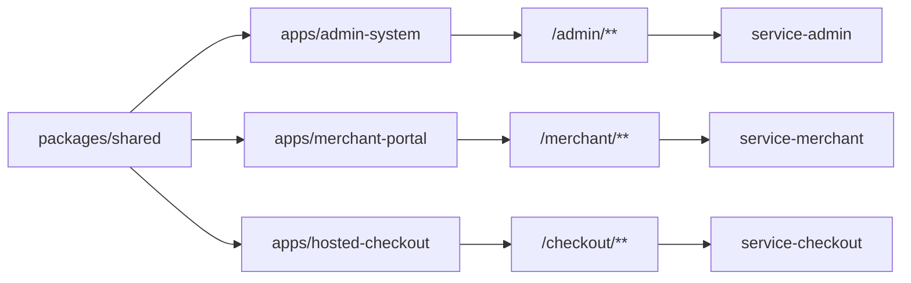

# 前端架构收敛路线图

## 1. 文档定位

本文描述 `acquiring-frontend` 作为支付收单平台前端仓库的当前结构、架构约束和后续收敛方向。

后端仓库是：

```text
/Users/scott/Documents/code/ideaCodex/acquiring-orchestration
```

前端仓库只维护 Vue 前端应用和共享前端包，不生成后端 Java 代码，不自行发明后端不存在的支付业务接口。

## 2. 当前应用结构

```text
acquiring-frontend
├── apps
│   ├── admin-system
│   ├── merchant-portal
│   └── hosted-checkout
└── packages
    └── shared
```

职责：

1. `apps/admin-system`：后台管理系统，对接 `/admin/**`。
2. `apps/merchant-portal`：商户后台，对接 `/merchant/**`。
3. `apps/hosted-checkout`：Hosted Checkout 收银台，对接 `/checkout/**`。
4. `packages/shared`：品牌、支付图标、通用 HTTP 客户端、通用类型、通用展示工具。

## 3. 前端架构关系图



## 4. 当前扫描结论

### 4.1 `admin-system`

当前状态：

1. 已使用 `packages/shared` 的 `createHttpClient` 作为主要请求封装。
2. 请求会自动注入 `Authorization`、`X-Request-Id`、操作者信息、商户上下文和 `Accept-Language`。
3. 路由根据后端返回菜单动态生成。
4. `hydrateSession()` 会在路由权限判断前刷新登录态和菜单，支持权限页深链刷新。
5. 已具备 `v-hasPermi`、`v-hasRole` 权限指令。
6. 已有 `BaseDateTime`、`BaseAmount`、`BaseStatusTag`、`RightToolbar` 等后台通用组件。

需要继续收敛：

1. 少量旧 `utils/request.ts` axios 封装仍存在，应逐步迁移到共享 HTTP 客户端。
2. 支付、退款、代付、结算、通道页面入口需要以后端真实交易能力为准，不要做假业务闭环。
3. 敏感密钥页面必须继续默认展示摘要、版本、算法、指纹，不展示完整密钥。

### 4.2 `merchant-portal`

当前状态：

1. 已使用共享 `createHttpClient`。
2. 已通过后端菜单动态生成商户侧路由。
3. 已有商户账号、部门、岗位、角色、菜单授权等系统管理页面。
4. 商户 session 独立存储，与后台管理 session 隔离。

需要继续收敛：

1. 交易、订单、退款、结算页面必须等待后端真实接口支撑。
2. 页面不得自行推导资金状态或虚构交易状态。
3. 商户数据必须以后端返回的商户上下文和权限为准，不允许前端通过路由参数越权拼接查询。

### 4.3 `hosted-checkout`

当前状态：

1. 当前主要是收银台体验、品牌展示、支付方式展示和国家配置读取。
2. 已调用 `/checkout/config/countries` 获取国家配置。
3. 当前页面内的支付成功、失败、处理中、拦截状态属于前端预览态，不代表真实交易状态。

需要继续收敛：

1. 补齐 checkout session 查询。
2. 后端返回订单金额、币种、商户、商品摘要、支付方式配置。
3. 支付提交必须走后端受控接口。
4. 支付结果必须通过后端查询或回调状态确认。
5. 前端不得保存 PAN、CVV、PIN，不得把卡敏感数据写入日志或本地存储。

## 5. 共享层目标结构

目标结构：

```text
packages/shared/src
├── auth
├── http
├── result
├── types
├── brand
├── payment
└── utils
```

当前 `packages/shared/src/index.ts` 已承载较多类型和工具。后续可以在不改变外部导入行为的前提下，逐步拆分内部文件，再由 `index.ts` 统一导出。

## 6. 前端约束

### 6.1 API 约束

1. 新增 API 前必须先搜索现有 `api` 目录、后端接口和文档。
2. 不允许自行创造后端不存在的接口。
3. 请求协议处理放在 `api` 层或共享 HTTP 层，页面只处理业务对象。
4. 管理后台、商户后台必须使用对应 baseURL，不允许跨系统复用 token。

### 6.2 权限约束

1. 路由权限来自后端菜单和权限码。
2. 按钮权限使用 `v-hasPermi` 或等价共享能力。
3. 前端权限码必须与后端 `@RequiresPermission` 和数据库权限码一致。
4. 前端隐藏按钮不是安全边界，后端必须继续鉴权。

### 6.3 支付展示约束

1. 使用项目已有状态枚举，不发明 `DONE`、`COMPLETE`、`FINISHED` 等状态。
2. 金额展示必须包含币种。
3. 日期时间展示统一为 `yyyy-MM-dd HH:mm:ss`。
4. 卡号、邮箱、手机号、密钥、token 默认脱敏。
5. 不展示 CVV、PIN、完整卡号、完整密钥、JWT Secret。

### 6.4 Hosted Checkout 约束

1. 移动端优先，必须支持 375px 宽度。
2. 不使用后台管理式表格和复杂导航。
3. 收银台页面只展示后端授权的支付方式。
4. 支付动作必须防重复提交。
5. 支付按钮状态必须跟随后端会话和提交状态。

## 7. 分阶段收敛计划

### 第一阶段：统一请求层

1. 清理 `admin-system` 剩余旧请求封装使用点。
2. 将通用错误提示、未授权处理、请求 ID 注入统一保留在共享 HTTP 层。
3. 保持 admin 和 merchant session 独立。

### 第二阶段：统一菜单和权限工具

1. 抽取 admin 和 merchant 共用的菜单扁平化、动态路由辅助函数。
2. 保留各应用自己的布局、视图路径和权限显示策略。
3. 增加权限码一致性检查脚本或文档检查清单。

### 第三阶段：交易页面接入真实能力

1. admin 交易、退款、代付、结算、通道页面只接已落地的后端接口。
2. merchant 交易查询、订单查询、退款申请、结算查询按后端权限和数据范围接入。
3. 交易状态、金额、币种、渠道结果均以后端返回为准。

### 第四阶段：Hosted Checkout 真实链路

1. 接入 checkout session。
2. 接入支付方式配置。
3. 接入支付提交。
4. 接入支付结果查询。
5. 接入失败、处理中、风控拦截的真实状态展示。

## 8. 验证要求

前端架构调整后至少验证：

```bash
pnpm --filter admin-system build
pnpm --filter merchant-portal build
pnpm --filter hosted-checkout build
```

如涉及登录、菜单、权限或深链，还需要浏览器验证：

1. 未登录访问权限页跳转登录。
2. 登录后刷新权限页能恢复菜单和路由。
3. 无权限按钮不显示。
4. 无权限路由进入 403。
5. admin 和 merchant 登录态互不污染。

## 9. 2026-11-07 当前未完成展示治理清单

本节记录当前正在执行但尚未整体验收关闭的双端展示治理任务。以下九项均属于当前任务，不能因单个页面或单个状态完成而标记整项完成，也不能与后续新增产品需求混合统计。

### 9.1 验收项

| 编号 | 验收项 | 当前状态 | 完成定义 |
| --- | --- | --- | --- |
| 1 | 商户退款详情错误 | 已关闭，P0（2026-11-07） | 点击退款记录后，详情头部、状态、金额和交易类型均聚焦退款操作单；使用真实支付加退款数据验证，且不改变管理端正确逻辑 |
| 2 | 支付方式 Logo 全量统一 | 已关闭，P1（2026-11-07） | 管理端、商户端、收银台的列表、详情和下拉框统一尺寸与布局；保留已确认的交易详情样式，并导入现有支付方式资源供后续渠道复用 |
| 3 | 交易类型全量统一 | 已关闭，P1（2026-11-07） | 支付、授权、预授权、增量授权、请款、退款、撤销、代付等类型在列表、详情和下拉框统一使用“图标 + 国际化名称” |
| 4 | 交易状态全量统一 | 已关闭，P1（2026-11-08） | 列表统一使用“状态图标 + 国际化文字”，成功、失败、处理中和待处理的语义与颜色一致；不改已确认的交易详情状态样式和收银台支付成功样式 |
| 5 | 渠道管理完整覆盖 | 已关闭，P1（2026-11-07） | 渠道信息、MID、渠道能力、限额、商户 MID 绑定和渠道告警中的支付方式、交易类型、币种、金额及状态展示和选择控件全部统一 |
| 6 | 金额显示统一 | 已关闭，P1（2026-11-07） | 金额使用共享实现，按币种精度显示，不出现科学计数法、无意义尾零或币种丢失；已有金额胶囊保持原样，不强制增加币种 Logo |
| 7 | 汇率显示统一 | 已关闭，P1（2026-11-08） | 交易汇率、清分汇率、结算汇率、汇率快照和波动页面使用独立共享格式，默认最多八位小数，不出现科学计数法并清理无意义尾零 |
| 8 | 费率显示统一 | 已关闭，P1（2026-11-08） | 双端费率配置、审核、模拟、详情以及交易、清分、结算费用展示统一；百分比最多两位小数，固定费、最低/最高费、阶梯费率和保证金比例语义正确 |
| 9 | 全系统相似问题扫描 | 已关闭，P1（2026-11-08） | 扫描所有直接拼接币种、金额、汇率、费率、支付方式、交易类型和状态枚举的代码，补充共享格式测试，并完成管理端、商户端和收银台真实浏览器回归 |

收银台 `PENDING` 独立状态及样式只作为第 4 项的一个子项；第 4 项最终关闭以双端列表、查询控件和
真实成功/失败数据回归共同通过为准。

交易状态已完成双端真实数据回归：管理端订单跟踪、交易查询及商户端交易查询、退款列表中的成功、
失败状态均按“状态图标 + 国际化文字”展示，待处理和处理中状态在双端查询控件中保持同一语义；已确认
的交易详情头部状态和收银台成功页未改动。双端控制台无应用 error/warn，未将审批、结算或渠道原始
状态错误套用为交易状态组件。

支付方式 Logo 已完成管理端、商户端、收银台静态扫描，并在真实管理端页面验证渠道支付能力、
渠道告警规则和渠道限额的列表、下拉选项、选中态及历史停用值降级。Admin lint、typecheck、
build 和 `git diff --check` 均通过；浏览器业务接口无失败，控制台无 error/warn。商户实际支付能力
因当前开发库无记录，仅完成代码路径校验，后续随真实数据继续回归，不阻塞本项展示收敛关闭。

交易类型已完成管理端、商户端和收银台可视化代码路径扫描：列表、详情、查询下拉、费率规则和
渠道能力均统一复用 `TransactionTypeDisplay`，仅收银台商户回跳表单中的协议字段不属于可视化
展示。真实管理端渠道能力弹窗验证 11 个启用交易类型均有图标，选择后的标签继续显示图标，
取消弹窗后未保存业务数据；费率配置已验证多选、折叠标签及中英文名称。Shared、Admin、Merchant、
Hosted Checkout 的 typecheck/build、聚焦 lint 和 `git diff --check` 均通过，控制台仅有浏览器翻译
扩展错误，无应用 error/warn。

渠道管理已完成七个页面的静态扫描与真实管理端回归：渠道信息、渠道支付能力、渠道限额、渠道
MID、商户 MID 绑定均使用真实列表、分页和详情数据验证；渠道告警规则在空数据环境下验证新增表单
中的支付方式、卡品牌下拉与选中态，渠道告警事件验证查询和空态，并对无真实数据的详情路径完成
源码核验。渠道限额币种按后端和表结构既有契约继续固定为 USD；所有新增、详情弹窗均已取消或关闭，
未写入测试业务数据。Shared/Admin typecheck、Admin production build、渠道目录聚焦 lint 和
`git diff --check` 均通过，控制台无应用 error/warn。

金额显示已收敛至共享字符串精度实现：金额最多展示币种精度对应的小数位并清理无意义尾零，
HALF_UP 舍入、零小数币种、科学计数法、超大整数、负零和非法远端值均有自动化测试覆盖；既有金额
胶囊结构未改动。真实管理端风控记录、基础币种、渠道限额和交易链路页面已验证币种、金额及币种
Logo 展示，收银台 `PENDING` 页面已完成桌面端刷新交互和 `390x844` 移动端无横向溢出验证，控制台
无应用 error/warn。商户端本轮浏览器会话停留在图形验证码登录页，未绕过认证；其首页、交易、退款、
账户、结算和保证金金额路径已完成共享实现扫描，并由 Shared/Admin/Merchant/Hosted Checkout
typecheck、三端 production build、全前端 lint、金额测试 `7/7` 和 `git diff --check` 共同验证。

汇率显示代码已统一使用共享字符串精度实现：交易汇率、汇率管理、使用快照、波动列表及 tooltip、
预警证据、清分/结算直兑汇率和费率模拟中的结算汇率均最多展示八位小数，清理无意义尾零且不使用
科学计数法；图表中的 `Number` 转换仅用于 ECharts 坐标和相对波动可视化，不参与业务换算。共享金额、
汇率和费率测试现为 `10/10`，四工作区 typecheck、三端 production build、全前端 lint 和
`git diff --check` 均通过。真实管理端已验证汇率使用快照 `6097` 条列表和详情，以及汇率波动页
`34` 个币种对、`7` 条关注线、非空趋势图、币种旗帜和涨跌语义；汇率最多八位且不使用科学计数法，
控制台无应用 error/warn。

费率显示代码已统一使用共享百分比和金额格式：管理端与商户端费率详情、阶梯费率、固定费、最低/
最高费、保证金比例、计费公式，以及清分明细中的百分比费率和保证金比例均按既定语义展示；百分比
最多两位小数且不使用科学计数法。编辑表单的 `%` 输入后缀及原始字符串精度保持不变，避免改变保存
契约。共享测试现为 `9/9`，Shared/Admin/Merchant typecheck、聚焦 lint、Admin/Merchant production
build 和 `git diff --check` 均通过。真实页面已回归管理端费用模板详情、模板编辑、商户费率详情与
编辑，以及商户端当前费率：运营和商户侧均不再显示内部交易类型，只展示具体支付方式；多支付方式
默认显示前两个 Logo 与剩余数量，悬浮展示完整清单；下拉中不存在“全部银行卡”聚合项。所有编辑
弹窗均取消退出，未保存业务数据，双端控制台无应用 error/warn。

第五批相似问题扫描已完成：汇率使用快照中的支付、请款、授权统一使用交易类型组件；资金、商户、
费率、汇率预警和统一待办中的非胶囊币种、币种对及金额统一复用共享展示；费用试算和统一待办共
`11` 处旧 `BaseAmount` 已迁移，仓库内不再保留其业务引用。费用试算已按后端匹配契约收紧：银行卡
必须选择具体卡品牌，非银行卡仅在请求内部使用 `ALL`，页面不再展示“全部支付方式”。真实管理端
验证卡品牌下拉仅含 `8` 个具体品牌、PayPal 切换后的四列布局、商户详情结算币种和汇率页面，均未
保存测试数据且控制台无应用 error/warn。商户端本次最终抽样时登录态过期，未从配置提取账号密码；
其既有真实交易、退款、费率回归证据及 Merchant typecheck/build 继续作为关闭依据。

商户退款详情已使用真实同主链路支付与退款数据完成浏览器回归：退款详情聚焦
`AUD 91.19 / REFUND / SUCCESS / 202611071336262034592`，动作时间轴保留原支付
`AUD 133.91 / PAYMENT`。同时通过 Merchant 桌面及移动 E2E、Merchant typecheck/build、全前端
lint，以及 `service-merchant` 详情 Controller 与 JDBC 查询聚焦测试；回归用例位于
`e2e/merchant-transaction-order-detail.spec.ts`。

### 9.2 执行顺序

1. 第一批：修复并真实回归商户退款详情 P0 问题。
2. 第二批：完成支付方式、交易类型和交易状态的全量统一。
3. 第三批：完成渠道管理目录的全页面覆盖。
4. 第四批：完成金额、汇率和费率的共享格式治理。
5. 第五批：执行全系统静态扫描、共享格式测试和双端及收银台浏览器回归，修复验收发现的问题后再整体关闭。

### 9.3 保护边界

1. 不修改 `acquiring-openapi-java-sdk`。
2. 不改变数据库金额、汇率、费率的存储值，不改变资金计算、清分、结算或 API 契约。
3. 不修改已经确认的交易详情 Logo、金额胶囊和收银台支付成功样式。
4. 前端展示必须以后端真实字段、数据字典和权限为准，不新增虚假枚举、状态或业务记录。
5. 验收期间不擅自启动、停止或重启用户运行的服务。
